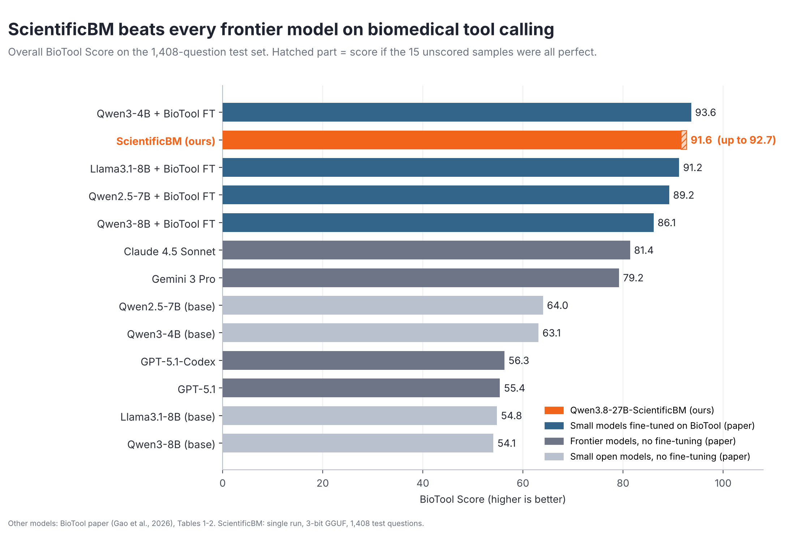
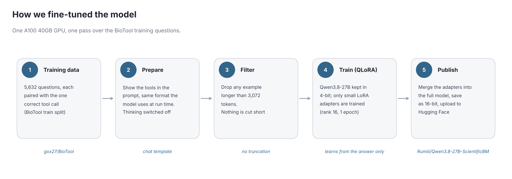
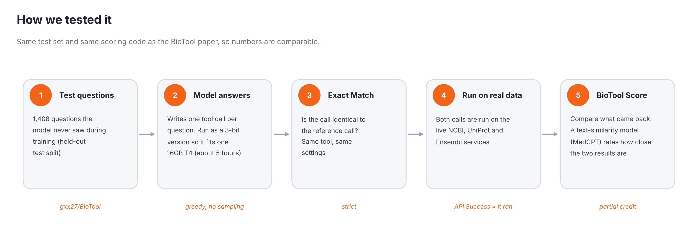
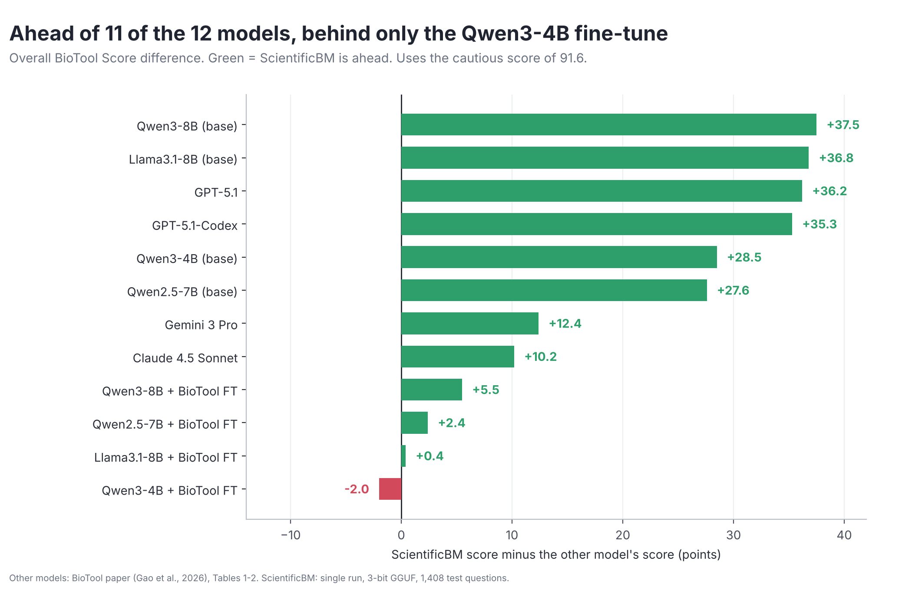
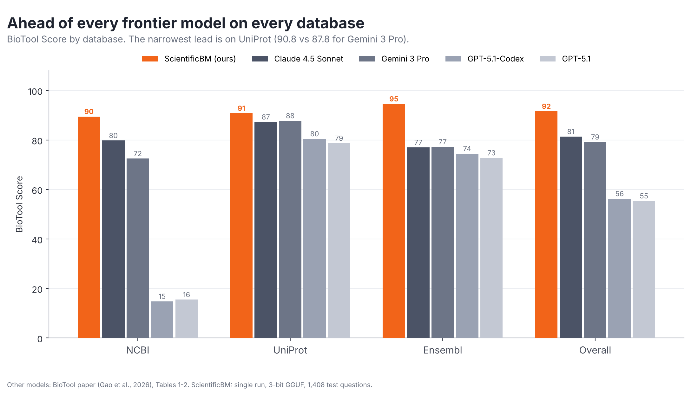
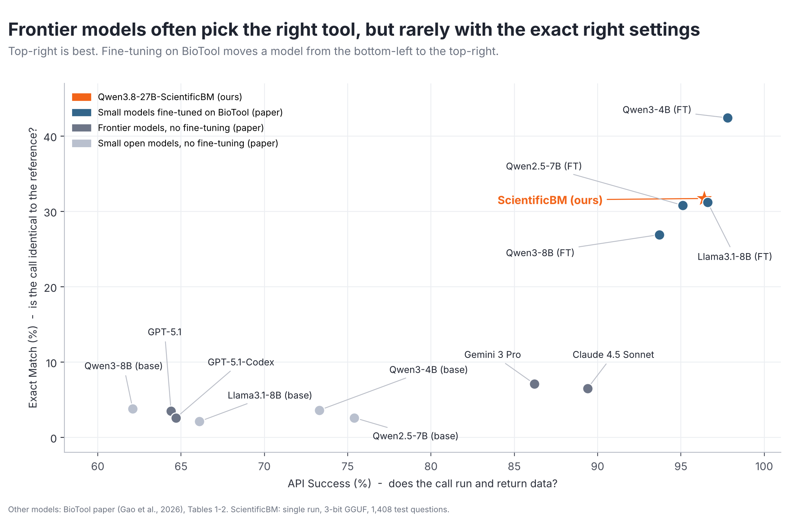

# Qwen3.8-27B-ScientificBM
Qwen3.8-27B-ScientificBM is a research model that converts natural-language biomedical questions into structured tool calls.

[Model on Hugging Face](https://huggingface.co/Rumiii/Qwen3.8-27B-ScientificBM) · [Small GGUF versions](https://huggingface.co/mradermacher/Qwen3.8-27B-ScientificBM-GGUF) · [BioTool dataset](https://huggingface.co/datasets/gxx27/BioTool) · [BioTool paper](https://arxiv.org/abs/2605.05758)

> **Research use only.** This model is not a medical device. Do not use it for diagnosis, treatment or any clinical decision.

---

## What does it do?

You ask a biology question in plain English. The model does not answer it from memory. Instead, it picks the right public database tool and fills in the settings, so your own code can run the lookup and get a real, checkable answer.

**Question**

> Map bases 100 to 200 of transcript ENST00000361390 to genomic coordinates in human.

**What the model writes**

```
map_cdna_to_genome(id="ENST00000361390", region="100..200", species="human")
```

The tools come from three public databases: **NCBI**, **UniProt** and **Ensembl**. There are 127 tools in total, from gene lookups to protein searches to sequence matching.

---

## How did it do?



In short:

- **It chose the correct tool for all 1,408 test questions.** Not one wrong tool and not one broken answer.
- **It beat all four frontier models** from the BioTool paper (Claude 4.5 Sonnet, Gemini 3 Pro, GPT-5.1 and GPT-5.1-Codex) on the overall score.
- **Out of the 12 models in the paper, it is ahead of 11.** The one it did not beat is the small Qwen3-4B model that was fine-tuned on the same data.
- **It is strongest on Ensembl** (score 94.6) and weakest at getting every setting exactly right (Exact Match 31.7%).

---

## How we fine-tuned it



The idea is simple. Show the model thousands of examples of "question → correct tool call" and let it learn the pattern.

**1. The data.** We used the training part of [BioTool](https://huggingface.co/datasets/gxx27/BioTool): 5,632 biomedical questions, each paired with the one correct tool call. Every example also lists the tools the model can choose from, just like it will see in real use.

**2. Same format as real use.** Each example is written in the model's own chat format, with "thinking" switched off. We want a short, clean tool call, not a long essay.

**3. No cut-off examples.** Any example longer than 3,072 tokens was dropped instead of being trimmed. That removed 139 of the 5,632 examples, leaving 5,493 for training. A trimmed tool call is a broken tool call, and we did not want the model to learn from those.

**4. Train only a small part (QLoRA).** A 27-billion-parameter model is huge, so we kept it compressed to 4-bit and trained only small add-on layers called LoRA adapters. This gives most of the benefit of full training at a fraction of the memory.

**5. Learn from the answer only.** The model is graded only on the tool call it writes, not on the question or the tool list that come before it. We checked this before training: the script prints what the model is learning from and stops if it is wrong.

**6. Merge and publish.** The adapters were merged back into the full model, saved as a regular 16-bit model and uploaded to Hugging Face.

| Setting | Value |
|---|---|
| Starting model | Qwen3.8-27B (4-bit, via Unsloth) |
| Training data | BioTool train split: 5,632 examples, 5,493 used (139 over-long ones dropped) |
| Method | QLoRA, adapters on attention and MLP layers |
| LoRA size | rank 16 |
| Learning rate | 2e-4 |
| Batch size | 16 (1 example × 16 accumulation steps) |
| Passes over the data | 1 epoch (344 steps, about 1 hour 45 minutes) |
| Longest example | 3,072 tokens |
| GPU | One A100 40GB |

The full script is in [`training/train_biotool.py`](training/train_biotool.py).

---

## How we tested it



We used the **official BioTool test set and scoring code**, so our numbers can be compared fairly with the paper.

- **The test.** 1,408 questions the model never saw in training.
- **The model's job.** For each question, write one tool call.
- **Three scores:**

| Score | In plain words |
|---|---|
| **Exact Match** | Is the call exactly the same as the reference call? Same tool, same settings. Very strict. |
| **API Success** | Did the call actually run and bring back data? |
| **BioTool Score** | Both calls (the model's and the reference) are run on the live databases. We then measure how similar the two results are. A call that is slightly different but returns almost the same data still gets most of the credit. |

- **A note on size.** The full 16-bit model needs about 55 GB of memory. To test it on a single free 16 GB Kaggle T4 GPU, we ran the **3-bit version** (Q3_K_M) of the model. That is a small quality trade-off, so the full 16-bit model may score a little higher. The 1,408 questions took about 5 hours.

The full benchmark script is in [`benchmark/run_benchmark.py`](benchmark/run_benchmark.py).

---

## The results

### Our scores

| Score (%) | NCBI | UniProt | Ensembl | **Overall** |
|---|---|---|---|---|
| Exact Match | 44.3 | 8.5 | 42.3 | **31.7** |
| API Success | 91.6 | 100.0 | 97.6 | **96.4** |
| BioTool Score | 89.5 | 90.8 | 94.6 | **91.6** |

### Against the models in the BioTool paper

Sorted by overall BioTool Score. Numbers for the other models are from the paper's Tables 1 and 2.

| # | Model | Type | BioTool Score | Exact Match | API Success | Did we beat it? |
|---|---|---|---|---|---|---|
| 1 | Qwen3-4B + BioTool fine-tune | Small, fine-tuned | 93.6 | 42.4 | 97.8 | No |
| **2** | **Qwen3.8-27B-ScientificBM (ours)** | **Fine-tuned** | **91.6** | **31.7** | **96.4** | |
| 3 | Llama3.1-8B + BioTool fine-tune | Small, fine-tuned | 91.2 | 31.2 | 96.6 | **Yes** (narrowly, by 0.4) |
| 4 | Qwen2.5-7B + BioTool fine-tune | Small, fine-tuned | 89.2 | 30.8 | 95.1 | **Yes** |
| 5 | Qwen3-8B + BioTool fine-tune | Small, fine-tuned | 86.1 | 26.9 | 93.7 | **Yes** |
| 6 | Claude 4.5 Sonnet | Frontier | 81.4 | 6.5 | 89.4 | **Yes** |
| 7 | Gemini 3 Pro | Frontier | 79.2 | 7.1 | 86.2 | **Yes** |
| 8 | Qwen2.5-7B (no fine-tune) | Small | 64.0 | 2.6 | 75.4 | **Yes** |
| 9 | Qwen3-4B (no fine-tune) | Small | 63.1 | 3.6 | 73.3 | **Yes** |
| 10 | GPT-5.1-Codex | Frontier | 56.3 | 2.6 | 64.7 | **Yes** |
| 11 | GPT-5.1 | Frontier | 55.4 | 3.5 | 64.4 | **Yes** |
| 12 | Llama3.1-8B (no fine-tune) | Small | 54.8 | 2.1 | 66.1 | **Yes** |
| 13 | Qwen3-8B (no fine-tune) | Small | 54.1 | 3.8 | 62.1 | **Yes** |



### Frontier models, database by database



The model is ahead of every frontier model on all three databases. The lead is biggest on NCBI and Ensembl, and narrowest on UniProt (90.8 vs 87.8 for Gemini 3 Pro).

### Picking the tool vs. getting the settings exactly right



Frontier models usually produce a call that runs, but they rarely match the reference settings exactly (Exact Match of 7% or less). Fine-tuning on BioTool changes this: our model's Exact Match is more than four times higher than the best frontier model's.

---

## What this means

**What works well**
- It never picks the wrong tool, even when a different, similar-looking tool is listed next to the right one.
- Its calls almost always run (94.2% API Success).
- A fine-tuned open model beats expensive frontier models at this specific job.

**What is still hard**
- Getting every optional setting exactly right. Most calls still differ from the reference in at least one optional setting, such as which fields to return or how to sort the results, and many of those calls still run fine.
- UniProt Exact Match is still low (8.5%), as it is for every model in the paper, probably because there are many valid ways to write the same search.

**A fair comparison with smaller models.** A 27B model fine-tuned for one epoch with QLoRA ends up slightly ahead of the 7B to 8B fine-tuned models, but behind the small 4B model from the paper. Bigger did not automatically mean better here.

---

## How to read these numbers honestly

- **The BioTool Score of 91.6 is a cautious floor.** 15 of the 1,408 questions (1.1%) are long DNA/protein sequence searches (BLAST). The live NCBI service is very slow for these and did not finish them in the time we allowed, so we counted them as failures. If all 15 had been perfect, the overall score would be 92.7, so the true score lies between **91.6 and 92.7**. On another 22 BLAST questions the reference call itself failed on the live NCBI service, so no model can earn similarity credit there (this is how the official scoring works). Because of this, the best model's 93.6 cannot be reached.
- **Exact Match is not affected** by those 15 questions. It only compares calls and does not run them.
- **One run, not three.** The paper averages three runs. We ran the model once, in 3-bit form.
- **The databases change over time.** Live results from NCBI, UniProt and Ensembl can move a little between runs. A gap as small as 0.4 points, like our lead over the Llama fine-tune, is small enough for this drift to matter.
- **A re-check was done after the first run.** The first run turned some of the model's text values (for example `null` and numbers) back into the wrong type. We fixed this and re-checked the 325 affected samples on the live services. The scores above include that re-check.

---

## Try it

Needs `transformers>=5` and a GPU with roughly 55 GB of memory for the 16-bit model. On a smaller GPU, use the [GGUF versions](https://huggingface.co/mradermacher/Qwen3.8-27B-ScientificBM-GGUF) or load the model in 4-bit.

```python
# pip install -U "transformers>=5" accelerate
import re, json, torch
from transformers import AutoTokenizer, AutoModelForMultimodalLM

model_id = "Rumiii/Qwen3.8-27B-ScientificBM"
tok = AutoTokenizer.from_pretrained(model_id)
model = AutoModelForMultimodalLM.from_pretrained(model_id, torch_dtype=torch.bfloat16, device_map="auto")

tools = [{
    "type": "function",
    "function": {
        "name": "map_cdna_to_genome",
        "description": "Convert from cDNA coordinates to genomic coordinates.",
        "parameters": {
            "type": "object",
            "properties": {
                "id": {"type": "string", "description": "An Ensembl stable ID"},
                "region": {"type": "string", "description": "Query region"},
                "include_original_region": {"type": "boolean", "description": "Include original input region"},
                "species": {"type": "string", "description": "Species name/alias"},
            },
            "required": ["id", "region"],
        },
    },
}]

messages = [
    {"role": "system", "content": "You are a helpful assistant that can call tools. Use the provided tools when appropriate."},
    {"role": "user", "content": "Map bases 100 to 200 of transcript ENST00000361390 to genomic coordinates in human."},
]

inputs = tok.apply_chat_template(messages, tools=tools, add_generation_prompt=True,
                                 enable_thinking=False, return_tensors="pt", return_dict=True).to(model.device)
out = model.generate(**inputs, max_new_tokens=256, do_sample=False)
text = tok.decode(out[0][inputs["input_ids"].shape[1]:], skip_special_tokens=True)
print(text)
```

Always turn thinking off (`enable_thinking=False`). The model was trained for short, direct tool calls.

---

## Limitations

- **Research only.** Never use the output for clinical decisions.
- **One tool call at a time.** It was not trained for multi-step chains and does not read tool results to write a final answer.
- **It always calls a tool.** Every training example ended in a tool call, so it may still call one when the question is not about biomedicine. Filter out-of-scope questions first.
- **Only the tools it has seen.** Behaviour on new tool definitions or other databases is not guaranteed.
- **Check before you run.** The model can add settings nobody asked for or write placeholder values. Validate each call against the tool definition before executing it.
- **Long tool lists.** Training examples longer than 3,072 tokens were left out, so very long prompts may work less reliably.

---

## What's in this repo

```
.
├── README.md
├── assets/                      graphs used in this README
├── training/
│   └── train_biotool.py         the fine-tuning script (Unsloth QLoRA)
└── benchmark/
    ├── run_benchmark.py         the benchmark script (Kaggle T4, official BioTool scoring)
    ├── revalidate_after_decoding_fix.py   re-checks the samples affected by the decoding fix
    ├── make_charts.py           rebuilds the graphs from the results file
    └── results/
        ├── model_comparison.csv   our scores next to the paper's models
        └── ScientificBM_metrics.json
```

### Re-run the fine-tuning

```bash
python training/train_biotool.py
```

Needs an A100 40GB (or similar). For a quick test, set `MAX_STEPS = 20` at the top of the script.

### Re-run the benchmark

On Kaggle, choose **GPU T4 ×1** and turn **Internet on**, then run:

```bash
python benchmark/run_benchmark.py
```

It downloads the test set and the official scoring code, runs the 3-bit model, scores everything, and saves the results and graphs to `/kaggle/working/`. Expect about 5 hours for the model to answer all 1,408 questions. If the session stops, run it again. It picks up where it left off.

### Rebuild the graphs

```bash
python benchmark/make_charts.py
```

---

## Credits

- **BioTool dataset and benchmark:** Gao et al., UC San Diego and MBZUAI. This work would not exist without it. [Paper](https://arxiv.org/abs/2605.05758) · [Code](https://github.com/gxx27/BioTool)
- **Base model:** Qwen3.8-27B by the Qwen team.
- **Training tools:** [Unsloth](https://github.com/unslothai/unsloth).
- **3-bit GGUF files used for the benchmark:** [mradermacher](https://huggingface.co/mradermacher/Qwen3.8-27B-ScientificBM-GGUF).

If you use this model, please also cite the BioTool dataset:

```bibtex
@misc{gao2026biotoolcomprehensivetoolcallingdataset,
      title={BioTool: A Comprehensive Tool-Calling Dataset for Enhancing Biomedical Capabilities of Large Language Models},
      author={Xin Gao and Ruiyi Zhang and Meixi Du and Peijia Qin and Pengtao Xie},
      year={2026},
      eprint={2605.05758},
      archivePrefix={arXiv},
      primaryClass={cs.CL},
      url={https://arxiv.org/abs/2605.05758},
}
```

## License

Apache-2.0, the same as the model and the BioTool dataset. The data returned by NCBI, UniProt and Ensembl follows each service's own terms.

*This model is provided for research purposes without warranty of any kind. Outputs may be incorrect or incomplete. Verify all tool calls and results independently before relying on them.*
